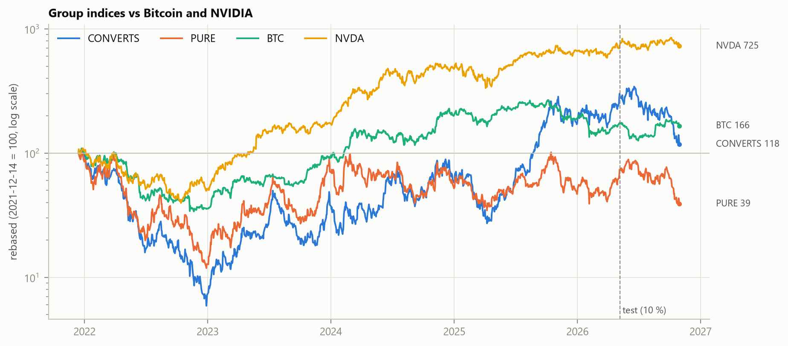
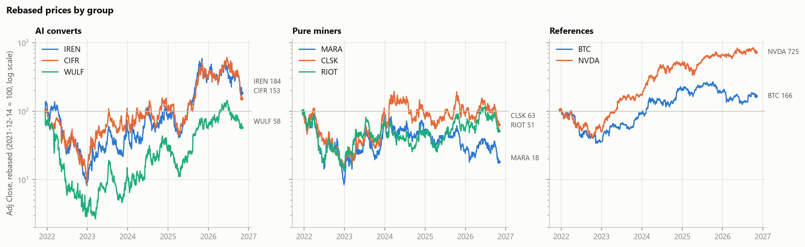
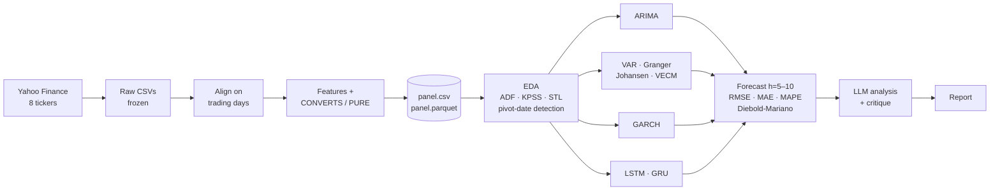

<div align="center">

# ⛏️ → 🤖 Did Bitcoin miners leave Bitcoin for AI?

**A time-series study of listed Bitcoin miners that pivoted to AI / HPC data centres, compared with those that stayed pure miners**

[](requirements.txt)
[](R/install_packages.R)
[](data/DATA_DICTIONARY.md)
[](PROGRESS.md)
[](config.yaml)

*Time-series mini-project · SDIA ING4 · Tek-Up · Option A (Finance)*



</div>

---

## 📌 The question

From 2024–2025, several listed Bitcoin miners began renting their power and data-centre capacity to AI and high-performance computing clients. Others stayed pure miners.

> **Did the AI converts lose their long-run link with Bitcoin and become tied to AI stocks, while pure miners stayed tied to Bitcoin?**

This is tested as two hypotheses. They are **not results yet**: results come in Phases 2–7.

| | Hypothesis | Main test |
|---|---|---|
| **H1** | Pure miners stay cointegrated with Bitcoin across the whole period | Johansen / Engle-Granger, VECM error-correction speed |
| **H2** | The AI converts' link to Bitcoin weakens, and their link to NVIDIA strengthens, after the pivot | Cointegration and Granger before/after the pivot, rolling correlation, DCC-GARCH |

## 🧺 Assets

| Group | Tickers | How they're modelled |
|---|---|---|
| 🤖 **AI converts** | `IREN` · `CIFR` · `WULF` | equal-weighted index **`CONVERTS`** |
| ⛏️ **Pure miners** | `MARA` · `CLSK` · `RIOT` | equal-weighted index **`PURE`** |
| ₿ **Bitcoin factor** | `BTC-USD` | reference series |
| 🧠 **AI factor** | `NVDA` | reference series |

The core models work on **4 series** (CONVERTS, PURE, BTC, NVDA). Averaging three firms per group removes much of the single-stock noise (contracts, dilutions, outages). The individual tickers stay in the panel for robustness checks.

<details>
<summary><b>Why the window starts on 14 Dec 2021</b></summary>

<br>

Yahoo returns WULF prices back to 1994 and CIFR prices back to 2020, but those rows belong to **other companies**. Before the mergers, WULF was IKONICS Corp. and CIFR was the Good Works SPAC. IREN only listed on 2021-11-17. The study therefore starts at TeraWulf's first trading session, **2021-12-14**, which gives 4.88 years of clean data. Full reasoning: [`data/DATA_DICTIONARY.md`](data/DATA_DICTIONARY.md).

</details>

## 📊 Dataset at a glance

| | |
|---|---|
| **Source** | Yahoo Finance via `yfinance` 1.8.0, frozen on 2026-11-09 |
| **Period** | 2021-12-14 → 2026-10-30 (daily) |
| **Observations** | **1,225** US trading days × **100** columns |
| **Calendar** | US stock trading days. BTC is sampled on those days (its weekend prices are dropped) |
| **Prices** | `Adj Close` (adjusted for splits and dividends) |
| **Features** | log price, log return, 20-day realised volatility (annualised), 20/50-day moving averages |
| **Split** | chronological 90 / 10 → **train** 1,102 rows (→ 2026-05-06) · **test** 123 rows (2026-05-07 →) |
| **Missing values** | none after alignment. One Yahoo placeholder row (CLSK, 2024-11-08) forward-filled and logged |



## 🔬 Methodology



The classical econometric core (ARIMA, VAR/VECM, GARCH) is implemented in **both Python and R**, as the brief requires (§8.1). The deep-learning models and the extensions are **Python only**, and each of those notebooks says so at the top.

Every model is fitted on the same frozen snapshot and the same chronological split, and writes its test-set forecasts in one common format (`date, model, horizon, y_true, y_pred, lower, upper`) to `results/forecasts_<model>.csv`. Phase 7 then compares all models from these files alone.

## 🗺️ Roadmap

| # | Phase | Brief | Grading block | Deliverable | Status |
|:-:|---|:-:|:-:|---|:-:|
| 1 | Data: download, alignment, features, indices, split | §1 | A | `01_data.ipynb` · `01_data.Rmd` | ✅ |
| 2 | EDA: ACF/PACF, STL, outliers, ADF + KPSS, **pivot-date detection** | §1.3, §2 | A | `02_eda.ipynb` | ⏭️ next |
| 3 | ARIMA / SARIMA + residual diagnostics, random-walk baseline | §3.1 | A | `03_arima` (py + R) | ⬜ |
| 4 | VAR, Granger, Johansen, VECM, before vs after the pivot | §3.2 | A + D | `04_var_vecm` (py + R) | ⬜ |
| 5 | ARCH-LM, GARCH family, conditional volatility vs events | §3.3 | B | `05_garch` (py + R) | ⬜ |
| 6 | LSTM / GRU, walk-forward validation, ARIMA + LSTM hybrid | §4 | B + D | `06_deep_learning.ipynb` | ⬜ |
| 7 | Forecast evaluation, Diebold-Mariano, rolling correlation, DCC-GARCH | §6, §7 | A + D | `07_evaluation.ipynb` | ⬜ |
| 8 | LLM-assisted analysis and critique (done by hand with a real LLM) | §5 | C | `llm/` | ⬜ |
| 9 | Report, defence notes, final reproducibility check | §8 | all | `report/` | ⬜ |

Grading blocks from the brief (§9): **A** fundamentals (10 pts) · **B** advanced modelling (4) · **C** generative AI and LLM (4) · **D** depth and extensions (2).

A detailed log of decisions and open questions is in [`PROGRESS.md`](PROGRESS.md).

## 🧾 Results

> *No results yet.* This section is filled in as phases finish, and every number here will come from an executed notebook in `results/`.

| Question | Evidence | Answer |
|---|---|---|
| Pivot date of the AI converts | rolling correlation, rolling Engle-Granger, break test (Phase 2) | *pending* |
| **H1**: pure miners stay cointegrated with BTC | Johansen / Engle-Granger, VECM α (Phase 4) | *pending* |
| **H2**: converts move from BTC to NVDA after the pivot | pre/post Granger and cointegration (Phase 4), rolling correlation, DCC (Phase 7) | *pending* |
| Best forecasting model at h = 5 and h = 10 | RMSE · MAE · MAPE + Diebold-Mariano vs random walk (Phase 7) | *pending* |

## 🚀 Quick start

```bash
git clone https://github.com/<your-username>/<repo-name>.git
cd <repo-name>
```

**Python 3.11**

```bash
python -m venv .venv
.venv\Scripts\activate            # Windows
# source .venv/bin/activate       # macOS / Linux
pip install -r requirements.txt
jupyter nbconvert --to notebook --execute --inplace notebooks/python/01_data.ipynb
```

**R ≥ 4.1** (plus [pandoc](https://pandoc.org/installing.html), which RStudio already bundles)

```bash
Rscript R/install_packages.R
Rscript -e "rmarkdown::render('notebooks/r/01_data.Rmd')"
```

Run the notebooks in numerical order. Each R notebook reads the panel produced by the Python notebook with the same number. Every path is relative: the code finds the project root by looking for `config.yaml`.

Running `01_data.ipynb` does **not** call Yahoo Finance when `data/raw/` is already filled: a ticker is only downloaded if its CSV is missing. To rebuild the snapshot from scratch on purpose, call `download_raw(force=True)` from `src/data.py` (results will then change slightly, see below).

## 🧭 Project conventions

- **One phase at a time**, in order (2 → 9). Each phase ends by re-running its notebooks from a fresh kernel and updating [`PROGRESS.md`](PROGRESS.md), which is the project's memory.
- **Code comments say *why***, not what: one line per block justifying the choice (brief §8.1).
- **Every statistical test** states H0, the statistic, the p-value and a written conclusion. Markdown commentary in the notebooks is in **French**.
- **No invented numbers:** every figure quoted in text comes from executed output. Non-significant or failed results are reported as they are.
- **Naming:** figures `figures/fig_<phase>_<nn>_<name>.png`, tables `results/<phase>_<name>.csv`, forecasts `results/forecasts_<model>.csv`.
- **Shared helpers** go in `src/` (Python) and `R/` (R), never copy-pasted between notebooks.

## 📁 Repository layout

```
├── config.yaml              # tickers, groups, dates, seed, split: the single source of truth
├── data/
│   ├── raw/                 # one CSV per ticker, as downloaded (+ _download_log.json)
│   ├── processed/           # panel.csv / panel.parquet used by every notebook
│   └── DATA_DICTIONARY.md   # every column, unit, adjustment and cleaning rule
├── notebooks/
│   ├── python/              # 01_data.ipynb → 07_evaluation.ipynb
│   └── r/                   # 01_data.Rmd → 05_garch.Rmd (+ knitted .html)
├── src/                     # Python helpers: config.py · data.py · plotting.py (metrics.py in Phase 7)
├── R/                       # R helpers: load_data.R · install_packages.R
├── figures/                 # fig_<phase>_<nn>_<name>.png
├── results/                 # tables (CSV) and forecasts_<model>.csv
├── llm/                     # statistics summary, prompts, full LLM answers, human-vs-LLM comparison
├── report/                  # final report (French) + defence notes
├── docs/                    # project brief (cahier des charges)
├── PROGRESS.md              # phase log: what was done, key numbers, decisions, open questions
└── requirements.txt         # pinned Python packages
```

## ♻️ Reproducibility

- **Frozen data:** raw files are downloaded once and never refreshed automatically. Yahoo back-adjusts and revises its history, so downloading again would silently change results.
- **One config:** dates, seed (`42`), split and groups live in [`config.yaml`](config.yaml) and are read by both languages.
- **Cross-language check:** `01_data.Rmd` recomputes summary statistics and compares them with Python's. The largest relative difference is 4.3 × 10⁻¹⁶.
- **Pinned environment:** Python versions in [`requirements.txt`](requirements.txt). R versions are printed by `install_packages.R` and by `sessionInfo()` in every R notebook.

## ⚠️ Known limitations

- **Window length:** the window is 4.88 years rather than 5, because the AI converts were only listed from 2021.
- **Close timing:** BTC's daily close (24:00 UTC) and the US stock close (20:00–21:00 UTC) are 3–4 hours apart. Same-day lead/lag effects must be read with care.
- **Calendar:** a Monday BTC return covers the whole weekend.
- **Basket size:** three small-cap firms per group still leaves some firm-specific noise in each index.
- **Pivot date:** not fixed yet (`pivot_date: null`). It will be detected from the data in Phase 2 rather than taken from the news.
- **Short test set:** the 10 % test window is 123 trading days (2026-05-07 → 2026-10-30), possibly after the pivot. Forecast comparisons describe that one regime only.
- **Not causality:** Granger causality means "helps predict", not "causes". The report reads it that way.

## 📚 Data & credits

- Prices: [Yahoo Finance](https://finance.yahoo.com) via [`yfinance`](https://github.com/ranaroussi/yfinance). The data is subject to Yahoo's terms of use and is provided here for educational purposes only.
- Course: *Séries Temporelles pour Data Science & IA*, Tek-Up.

> **Disclaimer:** this is an academic project. Nothing in this repository is investment advice.

<div align="center">
<sub>Made by <b>&lt;your name&gt;</b> · SDIA ING4 · Tek-Up · 2026</sub>
</div>
