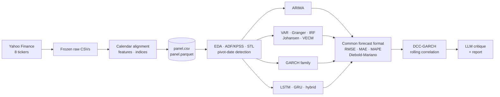
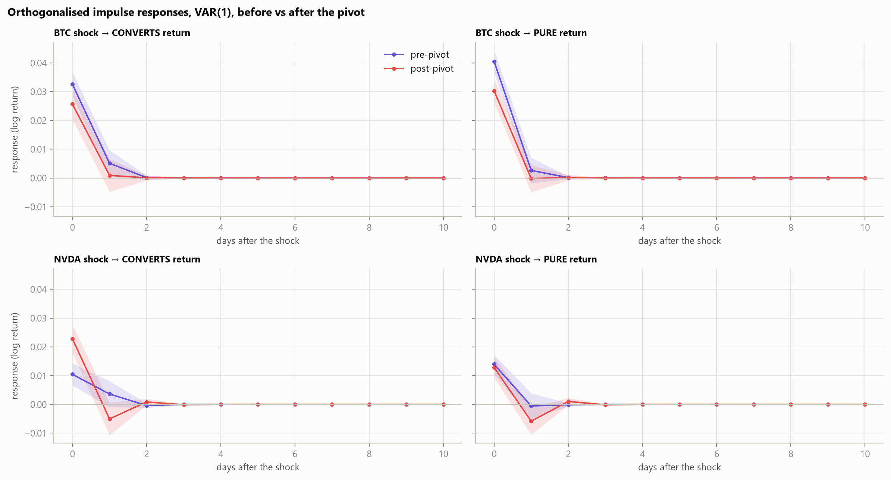
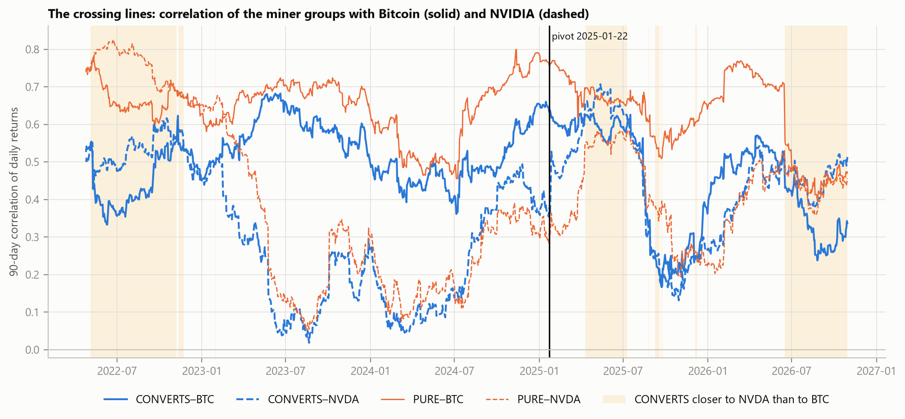
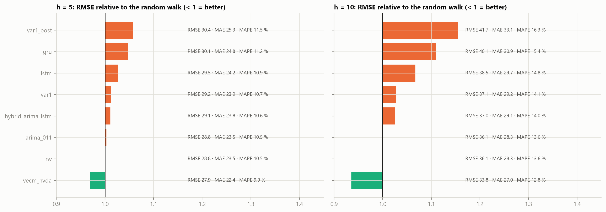

# Did Bitcoin Miners Leave Bitcoin for AI?

A multivariate time-series study of listed Bitcoin miners that pivoted to AI / HPC data centres, benchmarked against miners that stayed pure Bitcoin.

---

## Overview

Between 2024 and 2025, several listed Bitcoin miners started leasing their power capacity and data centres to AI and high-performance-computing clients. This project asks whether that business shift shows up in market prices:

> **Did the AI converts lose their link with Bitcoin and become tied to AI stocks, while pure miners stayed tied to Bitcoin?**

The study compares two equal-weighted indices over **1,225 US trading days (Dec 2021 – Oct 2026)**. Pure miners are a **control group**: a change that also hits them is a market effect, not an AI effect. The pivot date is **detected from the data** with structural-break tests rather than taken from the news.

The classical econometric core is implemented in **both Python and R**, and the two are cross-checked result by result. Deep learning and the extensions are Python only.

## Key findings

| | Finding | Evidence |
|---|---|---|
| 📍 | **The pivot is detected on 22 Jan 2025**, for converts only | Chow F = 8.63 (p = 1.2·10⁻⁵) for CONVERTS vs p = 0.15 for PURE; robust to removing the most extreme day |
| 🧠 | **The converts gained AI exposure.** Their same-day response to an NVIDIA shock **doubles** after the pivot | Impulse response 0.0105 → 0.0228 (disjoint 95 % bands); PURE unchanged (0.0140 → 0.0128) |
| ₿ | **…without leaving Bitcoin.** Their BTC link falls only slightly, and by as much as the pure miners' | BTC shock response −21 % (converts) vs −25 % (pure); BTC remains their largest driver |
| 🔗 | **No long-run or predictive link with Bitcoin**, for either group | No Johansen cointegration with BTC in any period (**H1 not supported**); no robust Granger causality |
| 📈 | **Dynamic correlation with NVIDIA rises for converts only** | DCC-GARCH CONVERTS–NVDA 0.33 → 0.42; NVDA overtakes BTC as the more correlated asset on 40 % of post-pivot days (pure miners: 3 %) |
| 🎯 | **No model beats the random walk** at 1–2 weeks | Best model VECM CONVERTS–NVDA: RMSE −3 % (h = 5) and −6 % (h = 10), not significant (Diebold-Mariano p ≈ 0.5) |

**Bottom line:** the converts did not *leave* Bitcoin. They **added** an AI factor on top of it. Consistent with efficient markets, that change is visible in co-movements but cannot be exploited for forecasting.

## Data

| Group | Tickers | Series |
|---|---|---|
| AI / HPC converts | `IREN` · `CIFR` · `WULF` | equal-weighted index **`CONVERTS`** (studied group) |
| Pure Bitcoin miners | `MARA` · `CLSK` · `RIOT` | equal-weighted index **`PURE`** (control group) |
| Bitcoin factor | `BTC-USD` | reference |
| AI factor | `NVDA` | reference |

| | |
|---|---|
| **Source** | Yahoo Finance via `yfinance` 1.8.0, downloaded once on 2026-11-09 and frozen |
| **Window** | 2021-12-14 → 2026-10-30 · **1,225** trading days × 100 columns |
| **Prices** | `Adj Close` (splits and dividends, including NVDA's 10-for-1 split of June 2024) |
| **Calendar** | US stock trading days; BTC (traded 7 days a week) is sampled on those days |
| **Indices** | mean of members' daily log returns, cumulated and rebased to 100 |
| **Features** | log price, log return, 20-day realised volatility (annualised), 20/50-day moving averages |
| **Split** | chronological 90 / 10: train 1,102 days (→ 2026-05-06), test 123 days (2026-05-07 →), test entirely post-pivot |
| **Cleaning** | one Yahoo placeholder row (CLSK, 2024-11-08) forward-filled and logged; no other missing value |

<details>
<summary><b>Why the window starts on 14 Dec 2021 (4.88 years instead of 5)</b></summary>

<br>

Before their mergers, Yahoo's WULF history belongs to IKONICS Corp. and CIFR's to the Good Works SPAC; IREN only listed on 2021-11-17. The window therefore starts at TeraWulf's first trading session, which is visible in the raw data as a ≈7× jump in traded volume. Full reasoning in [`data/DATA_DICTIONARY.md`](data/DATA_DICTIONARY.md).

</details>

## Methodology



| Phase | Content | Python | R |
|:-:|---|:-:|:-:|
| 1 | Download, calendar alignment, features, indices, 90/10 split | `01_data.ipynb` | `01_data.Rmd` |
| 2 | Descriptive stats, ACF/PACF, STL, outliers, ADF + KPSS, **structural breaks** (Chow scan, Bai-Perron) | `02_eda.ipynb` | — |
| 3 | ARIMA / SARIMA identification, residual diagnostics, random-walk baseline | `03_arima.ipynb` | `03_arima.Rmd` |
| 4 | VAR, Granger causality, impulse responses, Johansen / Engle-Granger, VECM, pre vs post pivot | `04_var_vecm.ipynb` | `04_var_vecm.Rmd` |
| 5 | ARCH-LM, GARCH / GJR / EGARCH (Normal and Student-t), volatility around events | `05_garch.ipynb` | `05_garch.Rmd` |
| 6 | LSTM and GRU grid, walk-forward validation, ARIMA + LSTM hybrid | `06_deep_learning.ipynb` | — |
| 7 | Out-of-sample evaluation, Diebold-Mariano, rolling correlation, DCC-GARCH | `07_evaluation.ipynb` | `07_dcc.Rmd` |
| 8 | Generative-AI critique: LLM given a numbers-only summary, answers checked claim by claim | `llm/` | — |

**Evaluation protocol.** Every model is fitted on the training set only (never re-estimated) and forecasts the CONVERTS level 1–10 days ahead from rolling origins over the same test dates. Forecasts are written in one shared format (`date, model, horizon, y_true, y_pred, lower, upper`) to `results/forecasts_<model>.csv`, so Phase 7 compares all models from these files alone.

**Cross-language validation.** Each R notebook reads the outputs of the Python notebook with the same number and compares them: identical input data (max relative difference 4.3·10⁻¹⁶), ARIMA coefficients within 1.5 %, DCC trajectories correlated at ≥ 0.9996. The Diebold-Mariano implementation in `src/metrics.py` is unit-tested against R's `forecast::dm.test` to 10⁻⁸.

## Results

### Short-run exposure: impulse responses before and after the pivot



### Dynamic correlation: NVIDIA overtakes Bitcoin for the converts only



| Pair | DCC correlation pre-pivot | DCC correlation post-pivot |
|---|:-:|:-:|
| CONVERTS – NVDA | 0.334 | **0.418** |
| CONVERTS – BTC | 0.501 | 0.477 |
| PURE – NVDA | 0.409 | 0.418 |
| PURE – BTC | 0.650 | 0.634 |

### Forecasting: test-set accuracy relative to the random walk



| Model | RMSE h = 5 | ratio vs RW | RMSE h = 10 | ratio vs RW | DM vs RW (h = 5) |
|---|:-:|:-:|:-:|:-:|---|
| **VECM CONVERTS–NVDA** | **27.86** | **0.969** | **33.78** | **0.936** | not significant (p = 0.49) |
| Random walk | 28.77 | 1.000 | 36.10 | 1.000 | — |
| ARIMA(0,1,1) | 28.85 | 1.003 | 36.15 | 1.001 | not significant |
| ARIMA + LSTM hybrid | 29.09 | 1.011 | 36.99 | 1.025 | **worse** (p = 0.009) |
| VAR(1) | 29.15 | 1.013 | 37.10 | 1.028 | not significant |
| LSTM | 29.53 | 1.026 | 38.53 | 1.068 | not significant |
| GRU | 30.13 | 1.047 | 40.07 | 1.110 | not significant |

Errors in index points (the CONVERTS index starts at 100). Full table, including MAE, MAPE, interval coverage and training time: [`results/model_comparison.csv`](results/model_comparison.csv).

<details>
<summary><b>More results</b></summary>

<br>

- **Stationarity.** Log prices are I(1) for all four series (ADF and KPSS agree); log returns are stationary.
- **No seasonality.** STL seasonal strength ≤ 0.03 (weekly), no day-of-week effect (ANOVA p ≥ 0.26), so no SARIMA.
- **ARIMA.** CONVERTS is a random walk: ARIMA(0,1,0) is chosen by BIC, `auto_arima` and R's `auto.arima`.
- **Cointegration.** Only CONVERTS–NVDA is cointegrated, on the full and pre-pivot samples, and the result is borderline (it depends on the critical-value table). Half-life of deviations ≈ 64 trading days.
- **Volatility.** GARCH(1,1) with Student-t errors is retained. There is a clear ARCH effect for PURE, BTC and NVDA, but not for the CONVERTS index (firm-specific spikes dilute in the average). After the pivot, CONVERTS volatility co-moves as much with NVDA (0.31) as with BTC (0.27), against 0.06 and 0.32 before.
- **Deep learning.** All 12 LSTM/GRU configurations end at random-walk level (validation-loss ratio 0.995–0.9997). Walk-forward validation (5 expanding folds) confirms it.

The decision log behind every result is in [`PROGRESS.md`](PROGRESS.md).

</details>

## Reproducing the results

```bash
git clone https://github.com/ghadakhchimi5-dot/Bitcoin-miners.git
cd Bitcoin-miners
```

**Python 3.11**

```bash
python -m venv .venv
.venv\Scripts\activate              # Windows
# source .venv/bin/activate         # macOS / Linux
pip install -r requirements.txt

jupyter nbconvert --to notebook --execute --inplace notebooks/python/*.ipynb
python -m pytest tests -q
python llm/make_stats_summary.py
```

**R ≥ 4.1** (with [pandoc](https://pandoc.org/installing.html), bundled with RStudio)

```bash
Rscript R/install_packages.R
Rscript -e "for (f in sort(Sys.glob('notebooks/r/*.Rmd'))) rmarkdown::render(f)"
```

Run each R notebook **after** the Python notebook with the same number: the R side reads the Python outputs and checks agreement.

- **Frozen data.** `01_data.ipynb` never calls Yahoo when `data/raw/` is filled, because Yahoo revises adjusted history. Use `download_raw(force=True)` from `src/data.py` only to rebuild the snapshot on purpose (results will change slightly).
- **Single configuration.** Tickers, dates, seed (42), split and pivot date live in [`config.yaml`](config.yaml), which both languages read. All paths are relative to the folder containing it.
- **Deterministic training.** PyTorch runs in deterministic mode with a fixed seed; seed sensitivity is reported in `results/06_seed_sensitivity.csv`.

## Repository structure

```
├── config.yaml             # single source of truth: tickers, groups, dates, seed, split, pivot date
├── data/
│   ├── raw/                # one frozen CSV per ticker + _download_log.json
│   ├── processed/          # panel.csv / panel.parquet, read by every notebook
│   └── DATA_DICTIONARY.md  # columns, units, adjustments, cleaning rules
├── notebooks/
│   ├── python/             # 01_data → 07_evaluation
│   └── r/                  # 01, 03, 04, 05, 07 (.Rmd + knitted .html)
├── src/                    # Python package: data, eda, arima, multivariate, garch, dl, dcc, metrics, plotting
├── R/                      # R helpers: data loading, ARIMA, VAR, package installer
├── tests/                  # unit tests (Diebold-Mariano and point metrics vs R)
├── figures/                # fig_<phase>_<nn>_<name>.png
├── results/                # result tables and forecasts_<model>.csv
├── llm/                    # numbers-only summary, prompts, error checklist, comparison templates
├── docs/                   # course brief (French)
├── PROGRESS.md             # phase-by-phase log of decisions, key numbers and open questions
└── requirements.txt        # pinned Python environment
```

## Limitations

- **Short post-pivot sample.** 447 days after the pivot limits the power of cointegration tests and leaves post-pivot GARCH persistence poorly identified.
- **Pivot date found by scanning.** Chow p-values are therefore optimistic, and the transition looks gradual through 2025. 2024-02-27 and 2025-08-13 are kept as robustness dates.
- **Close-time mismatch.** BTC closes at 24:00 UTC, 3–4 hours after US stocks, and a Monday BTC return covers the weekend. This affects the Cholesky ordering of impulse responses.
- **Small baskets.** With three firms per index, a single contract or dilution still weighs heavily.
- **Single test regime.** 123 test days, all post-pivot and falling at the end. Transaction costs and liquidity are not modelled.
- **Granger ≠ causality.** "Helps predict" is not economic causation.

## Project status

Phases 1–7 are complete and reproducible from a fresh environment. Phase 8 (the generative-AI critique) has its material ready in `llm/`; the LLM experiment itself is carried out by hand. The written report is being finalised.

## Author

**Ghada Khchimi**
**WissEM Zaouga**
**Med Akrem Elouer** 

Developed as the mini-project of the course *Séries temporelles pour la Data Science & l'IA* (Option A: financial data).

## Data & disclaimer

Prices come from [Yahoo Finance](https://finance.yahoo.com) via [`yfinance`](https://github.com/ranaroussi/yfinance) and are subject to Yahoo's terms of use; they are included for educational purposes only.

> This is an academic project. Nothing in this repository is investment advice.
